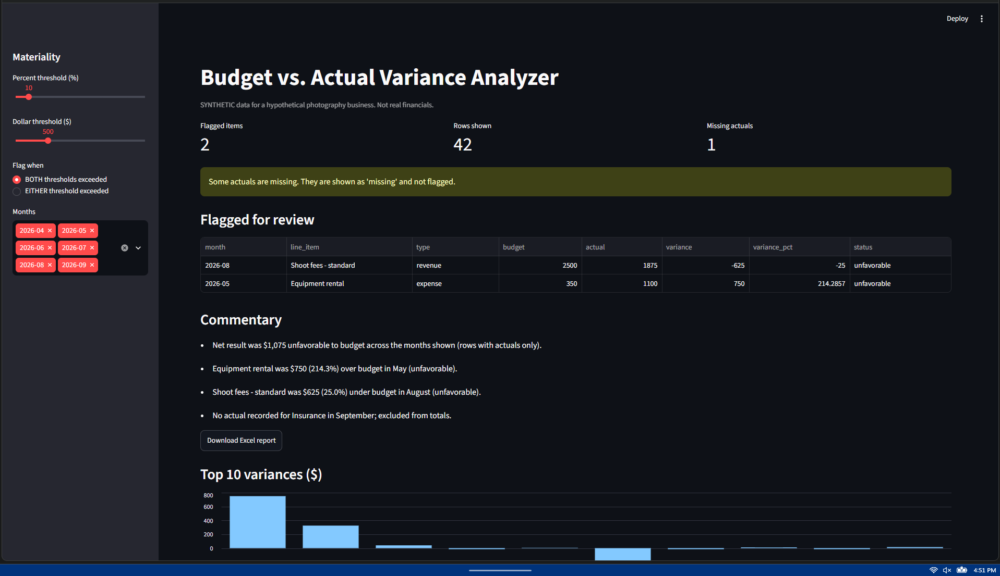

# Budget vs. Actual Variance Analyzer

Where did a small business overspend or underperform versus budget, and what should management look at first?

## Why it matters
A manager or FP&A analyst can use this to compare plan to results, see which gaps are big enough to matter, and get a plain-English summary and a one-page Excel report instead of scanning a spreadsheet by hand.

## Demo


Live app: [https://variance-analyzer-fwtcuncafnjstbpmnom6dm.streamlit.app/]

Sample output: [Variance memo](docs/memo.md)

## How it works
1. Loads `budget.csv` and `actuals.csv` and validates them (columns, types, duplicates).
2. Joins actuals to budget by month and line item. A missing actual stays visible as "missing".
3. Calculates variance in $ and %, and labels each row favorable or unfavorable (revenue and expense logic are opposite).
4. Flags rows over a materiality threshold you set (% and $, either BOTH or EITHER).
5. Writes rule-based commentary from the numbers and exports a one-page Excel report.

## Data
**All data is synthetic** and made up for a hypothetical photography business, generated by `src/generate_data.py`. It has planted situations (an equipment spike, a revenue dip, a zero-budget line, a missing month) so the logic can be tested. Not real financials.

## Results
- 42 budget rows and 41 actual rows (one actual deliberately missing).
- At the default thresholds (10% AND $500), the tool flags 2 items: Equipment rental in May (+$750, +214.3%) and standard shoot fees in August (-$625, -25.0%). Both were planted.
- 23 automated tests pass.
- Hand-checked: net variance of $1,075 unfavorable, and the August shoot variance of -25%. Both matched the tool.

## Limitations
- Synthetic data only; no forecasting; not accounting-grade statements.
- Commentary is rule-based: it reports what happened, not why.
- A $0 budget makes % variance undefined, so those rows are judged on dollars only.
- Thresholds are a judgment call and need to be tuned for each business.
- For real use: real data feeds, handling of multiple entities and currencies, accruals and timing, and review by an accountant.

## AI assistance
Claude (free chat) acted as a tutor: it explained variance analysis, proposed the project structure, and wrote first drafts of the loading, variance, commentary, export, and dashboard code and the tests.

What I did myself: chose the business scenario and the line items, rates, and planted situations for the synthetic data; typed the code into the project, ran it, and debugged setup problems on my own machine; ran the full test suite (23 passing); and compared the app's output and the exported Excel file against the planted situations.

## Run it
```bash
pip install -r requirements.txt
python src/generate_data.py
python -m pytest
python -m streamlit run app.py
```